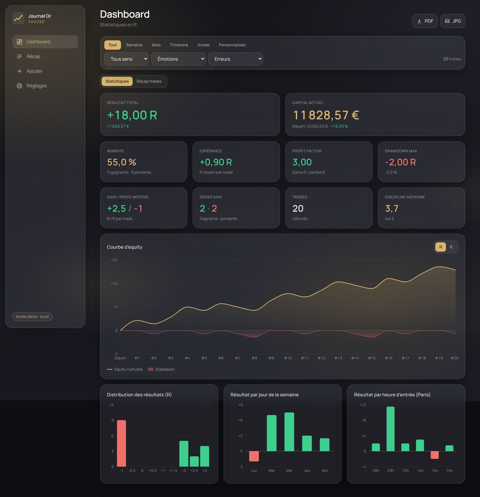

# Journal de trading XAUUSD

Application web personnelle pour tenir un journal de trading sur l'or (XAUUSD) : saisie des trades, captures d'écran, émotions, et un dashboard de statistiques en R.

- **Vite + React + TypeScript + Tailwind**, graphiques **Recharts**
- **Aucune base de données** : les trades sont dans `data/trades.json` et les captures dans `data/screenshots/` d'un **repo GitHub privé**. L'application y fait elle-même des commits via l'API GitHub.
- **Installable sur iPhone** (PWA), responsive Mac et mobile
- Interface entièrement en français, heures affichées en heure de Paris



Exemple de PDF « Récap trades » : [docs/exemple-recap-trades.pdf](docs/exemple-recap-trades.pdf)

---

## 🔒 Organisation : deux repos

```
┌──────────────────────────────┐        ┌──────────────────────────────────┐
│ journal-xauusd   (PUBLIC)    │        │ journal-xauusd-data   (PRIVÉ)    │
│ le code de l'application     │        │ vos données                      │
│ → publié sur GitHub Pages    │ token  │ data/trades.json                 │
│ aucune donnée personnelle    │ ─────► │ data/screenshots/*.webp          │
└──────────────────────────────┘        └──────────────────────────────────┘
```

- **`journal-xauusd`** (public) contient le code. GitHub Pages le publie gratuitement à l'adresse `https://VOTRE-PSEUDO.github.io/journal-xauusd/`. Le site n'affiche que 20 trades **fictifs** de démonstration tant qu'aucun token n'est saisi.
- **`journal-xauusd-data`** (privé) contient **vos trades et vos captures**. Personne d'autre ne peut le lire. L'application y écrit directement (un commit par trade) grâce à un token limité à ce seul repo.
- Le **token** n'est enregistré que dans le navigateur où vous l'avez saisi (localStorage). Il n'est jamais dans le code.

> Le site est marqué « noindex » : les moteurs de recherche ne le référencent pas.

---

## Étape 1 : créer les deux repos

Créez un compte sur [github.com](https://github.com) si nécessaire, puis :

**Repo n°1, l'application**
1. Bouton **+** (en haut à droite) → **New repository**.
2. **Repository name** : `journal-xauusd`
3. **Public**
4. Ne cochez **rien** d'autre (pas de README) → **Create repository**.

**Repo n°2, vos données**
1. **+** → **New repository**.
2. **Repository name** : `journal-xauusd-data`
3. **Private** 🔒
4. Cochez **« Add a README file »**. C'est obligatoire : l'application a besoin que le repo contienne déjà au moins un fichier.
5. **Create repository**.

Le dossier `data/` sera créé automatiquement dans ce repo au premier trade enregistré.

## Étape 2 : envoyer le code dans le repo public

Dézippez le projet sur votre Mac. Évitez le glisser-déposer sur le site de GitHub : le Finder cache le dossier `.github`, qui contient le déploiement automatique, et il ne serait pas envoyé.

**Avec GitHub Desktop (sans ligne de commande)**
1. Installez [GitHub Desktop](https://desktop.github.com) et connectez-vous à votre compte.
2. **File** → **Add Local Repository…** → choisissez le dossier `journal-xauusd`. S'il indique que ce n'est pas un repo Git, cliquez sur **create a repository** puis **Create Repository**.
3. Cliquez sur **Publish repository**, gardez le nom `journal-xauusd` et **décochez « Keep this code private »**. Si GitHub Desktop indique que le nom existe déjà, supprimez le repo vide créé à l'étape 1 (Settings → tout en bas, **Delete this repository**) et recommencez.

**Ou avec le Terminal** (remplacez `VOTRE-PSEUDO`) :

```bash
cd ~/Downloads/journal-xauusd
```

```bash
git init -b main
```

```bash
git add . && git commit -m "Journal XAUUSD"
```

```bash
git remote add origin https://github.com/VOTRE-PSEUDO/journal-xauusd.git
```

```bash
git push -u origin main
```

## Étape 3 : activer GitHub Pages

1. Sur la page du repo **`journal-xauusd`** : **Settings** → **Pages** (menu de gauche).
2. **Build and deployment** → **Source** : choisissez **GitHub Actions**.
3. Ouvrez l'onglet **Actions**. Si le premier lancement est en rouge ❌ (il a démarré avant l'activation de Pages), cliquez dessus → **Re-run all jobs**.
4. Au bout d'une à deux minutes, une coche verte ✅ apparaît. L'application est en ligne à l'adresse :
   **`https://VOTRE-PSEUDO.github.io/journal-xauusd/`**

Le site se met à jour tout seul à chaque modification du code. Les trades que vous enregistrez vont dans l'autre repo et ne déclenchent aucun redéploiement.

## Étape 4 : créer le token (accès au seul repo privé)

1. Photo de profil → **Settings** → **Developer settings** (tout en bas à gauche) → **Personal access tokens** → **Fine-grained tokens** → **Generate new token**.
2. Remplissez :
   - **Token name** : `Journal XAUUSD`
   - **Expiration** : 1 an (GitHub vous préviendra par e-mail avant l'échéance)
   - **Repository access** : **Only select repositories** → choisissez **uniquement `journal-xauusd-data`**
   - **Permissions** → **Repository permissions** → **Contents** : **Read and write**. Ne touchez à rien d'autre. *Metadata : Read-only* s'ajoute tout seul, c'est normal.
3. **Generate token**, puis copiez immédiatement le code `github_pat_…`. Il ne sera plus jamais affiché.

Ce token ne peut que lire et écrire des fichiers dans `journal-xauusd-data`. Il ne donne accès ni à vos autres repos, ni à votre compte.

## Étape 5 : connecter l'application

1. Ouvrez l'application → **Réglages** → **Synchronisation GitHub**.
2. Remplissez :
   - **Propriétaire** : votre pseudo GitHub
   - **Repo de données (privé)** : `journal-xauusd-data` (pré-rempli)
   - **Branche** : `main`
   - **Token** : collez le `github_pat_…`
3. Cliquez sur **Tester et enregistrer**. Le message doit indiquer **« Connecté à …/journal-xauusd-data (privé ✓) »**. Si l'application signale un repo **PUBLIC**, vous avez indiqué le repo de l'application : corrigez le nom.
4. Les trades de démo disparaissent et votre journal démarre vide. Réglez votre **capital de départ** et votre **% de risque** juste au-dessus.

## Étape 6 : installer sur l'iPhone

1. Ouvrez `https://VOTRE-PSEUDO.github.io/journal-xauusd/` dans **Safari**.
2. Bouton **Partager** → **Sur l'écran d'accueil**.
3. Ouvrez l'application depuis l'icône → **Réglages** → saisissez à nouveau le token. L'application installée a son propre stockage, séparé de celui de Safari.

Les réglages d'apparence (thème, couleurs, polices) sont aussi à faire une fois par appareil.

## En cas de problème

| Message | Solution |
|---|---|
| « Token invalide ou expiré » | Le token a expiré ou a été mal copié : créez-en un nouveau (étape 4) et collez-le dans Réglages. |
| « Introuvable » (404) | Vérifiez le pseudo et le nom du repo, et que le token a bien accès à `journal-xauusd-data`. |
| « Accès refusé » (403) | La permission **Contents : Read and write** manque sur le token. |
| Le site affiche une page 404 | GitHub Pages n'est pas activé, ou le déploiement (onglet Actions) n'est pas encore terminé. |
| Token perdu ou volé | Supprimez-le sur GitHub (même page qu'à l'étape 4) : il cesse aussitôt de fonctionner. |

---

## Utilisation

- **Ajouter un trade** : sur mobile, le bouton doré **+** ; sur desktop, le menu **Ajouter**. Les boutons **TP touché / SL touché** remplissent le prix de sortie en un geste. Renseignez les **lots** pour un résultat en € exact ; sinon, le résultat est estimé à partir du % de risque. Le **taux EUR/USD** se remplit tout seul avec le cours de la **minute d'entrée** du trade (cours EUR/USDT Binance, repli sur le taux BCE du jour) et se recalcule si vous changez l'heure d'entrée ; il est enregistré avec le trade.
- **Synchronisation entre appareils** : chaque appareil (iPhone, ordinateur) doit avoir le token saisi dans ses Réglages. L'app relit GitHub quand vous revenez dessus et toutes les minutes. Le badge vert « Synchronisé » force une actualisation quand on le touche.
  - Les **réglages** (comptes, capital, % de risque, pips, onces par lot, taux EUR/USD, tags d'erreur **et apparence**) sont enregistrés dans `data/settings.json` du repo privé : ils sont **identiques sur tous vos appareils**.
  - Restent propres à chaque appareil : le token et les filtres du dashboard.
- **Plusieurs comptes** (Réglages → Comptes) : chacun a son nom, son capital de départ et son % de risque ; un nouveau compte reprend les réglages du compte principal. Chaque trade est rattaché à un compte, et le dashboard se filtre par compte (« Tous les comptes » additionne les capitaux).
- **Sélection multiple** (Récap) : cases à cocher (sur mobile, bouton « Sélectionner ») pour modifier en une fois le compte, le risque, les lots, le taux, les émotions, la discipline ou les erreurs de plusieurs trades, ou pour les supprimer.
  - L'app se **met à jour toute seule** quand une nouvelle version est publiée (sauf pendant la saisie d'un trade : un bandeau propose alors la mise à jour). Le numéro de version est affiché en bas des Réglages.
- **Captures** : prise de photo, galerie, glisser-déposer ou collage (⌘V). Les images sont compressées dans le navigateur (WebP, 1 600 px de large maximum, environ 50 à 150 Ko) avant le commit.
- **Filtres globaux** (période, sens, émotion, erreur) : ils s'appliquent aux KPI, aux graphiques et au récap. Pour une semaine, un mois, un trimestre ou une année, les flèches ‹ › permettent de naviguer d'une période à l'autre.
- **Récap trades** (menu *Récap*, ou onglet du Dashboard) : un tableau récapitulatif par **semaine, mois ou trimestre** (nombre de trades, winrate, R, €, meilleur et pire trade) ; un clic sur une ligne filtre sur cette période. En dessous, la liste détaillée des trades.
- **Exports** :
  - le bouton **Télécharger le PDF** du Récap produit un vrai document A4 : synthèse, récap par période et détail de chaque trade, en respectant les filtres actifs ;
  - le Dashboard s'exporte en **PDF** ou **JPG** tel qu'il est affiché ;
  - **Réglages → Exporter / Importer JSON** sert de sauvegarde.
- **Apparence** (Réglages) : 6 thèmes prêts à l'emploi, couleurs libres (accent, gains, pertes, fond, halo), police du texte, police des chiffres et taille du texte. Ces réglages sont propres à chaque appareil.

Chaque ajout, modification ou suppression crée un commit (`➕ Ajout du trade …`) dans le repo privé. L'historique Git sert donc aussi de sauvegarde. Si deux appareils enregistrent en même temps, l'application relit le fichier et réessaie automatiquement.

## Règles de calcul

| Grandeur | Formule |
|---|---|
| Pips | 1 $ de mouvement = **10 pips** par défaut (3903,56 → 3913,56 = 100 pips), réglable dans Réglages |
| R | (sortie − entrée) / (entrée − SL) pour un achat. Pour une vente, la même formule avec le signe inversé. Le R peut être saisi à la main (case « R manuel »). |
| € d'un trade, avec lots | mouvement en $ × lots × 100 oz ÷ taux EUR/USD (ex. 0,10 lot sur 10 $ = 100 $) ; onces par lot et taux réglables |
| € d'un trade, sans lots | capital **au moment du trade** × % de risque × R |
| € « exact du broker » | le montant saisi à la main est prioritaire sur les deux calculs (commissions et swap inclus) |
| Capital au moment du trade | capital de départ + € de tous les trades précédents (dans l'ordre chronologique) |
| Capital actuel | capital de départ + gains cumulés (tous les trades, sans filtre) |
| Winrate | trades à R > 0 / trades clôturés |
| Espérance | somme des R / nombre de trades |
| Profit factor | somme des R gagnants / somme des R perdants (en valeur absolue) |
| Drawdown max | plus forte baisse depuis un sommet de la courbe cumulée, en R et en % du capital |

Les euros ne sont **jamais figés** : si vous modifiez un ancien trade ou le capital de départ, tout est recalculé. Un trade sans prix de sortie est considéré comme « en cours » et exclu des statistiques.

## Format d'un trade (`data/trades.json` du repo privé)

```json
{
  "id": "t_2026-11-18_0930_a1b2",
  "symbol": "XAUUSD",
  "entryAt": "2026-11-18T09:30:00+01:00",
  "exitAt": "2026-11-18T11:05:00+01:00",
  "direction": "buy",
  "entryPrice": 2652.40,
  "stopLoss": 2649.40,
  "takeProfit": 2658.40,
  "exitPrice": 2658.40,
  "outcome": "tp",
  "riskPercent": 1,
  "accountId": "principal",
  "lots": 0.1,
  "pnlManual": null,
  "rMultiple": 2,
  "rManual": false,
  "screenshots": {
    "before": "data/screenshots/t_2026-11-18_0930_a1b2-avant-xxxx.webp",
    "after": "data/screenshots/t_2026-11-18_0930_a1b2-apres-xxxx.webp"
  },
  "notes": "Cassure de range asiatique…",
  "emotionBefore": "calme",
  "emotionAfter": "confiante",
  "discipline": 4,
  "errorTags": ["entrée trop tôt"],
  "createdAt": "2026-11-18T11:10:00Z",
  "updatedAt": "2026-11-18T11:10:00Z"
}
```

Émotions possibles : `calme`, `confiante`, `impatiente`, `stressée`, `frustrée`, `euphorique`, `fatiguée`.

## Développement

```bash
npm install
```

```bash
npm run dev
```

```bash
npm test
```

```bash
npm run build
```

`npm run demo` régénère les 20 trades fictifs de démonstration (`public/demo-trades.json`) et leurs captures SVG.

### Structure

```
src/
├── types/trade.ts          schéma (zod) d'un trade + réglages
├── lib/calc/               calculs purs, testés avec Vitest
│   ├── trade.ts            R, pips, € et chaîne de capital
│   ├── stats.ts            winrate, espérance, PF, séries, courbe d'equity
│   ├── drawdown.ts         drawdown en R et en %
│   ├── distribution.ts     histogramme, résultats par jour et par heure (Paris)
│   ├── filters.ts          filtres globaux et navigation par période
│   ├── recap.ts            récap par semaine / mois / trimestre
│   └── paris.ts            fuseau Europe/Paris (heure d'été comprise)
├── lib/github/             API contents : lecture, commit, gestion des conflits
├── lib/image/compress.ts   WebP, 1 600 px maximum
├── lib/export/             JSON, PDF (dashboard et récap trades), JPG
├── lib/theme.ts            thèmes, couleurs et polices réglables
├── hooks/                  état global (trades, réglages, filtres), compteurs animés
├── components/             layout, ui, dashboard, trades, formulaire
└── pages/                  Dashboard, Récap trades, Ajouter/Modifier, Réglages
```
